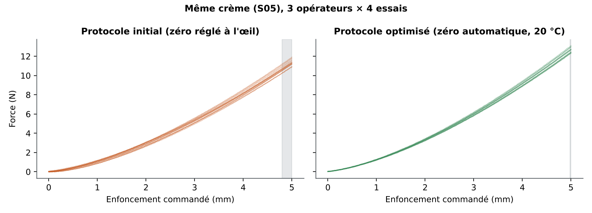
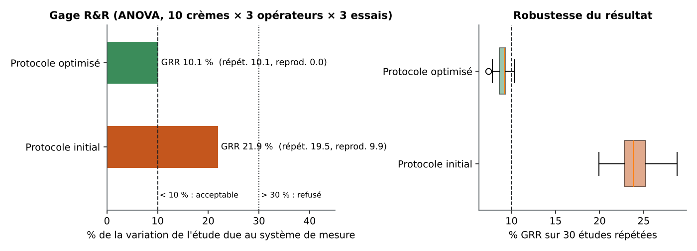
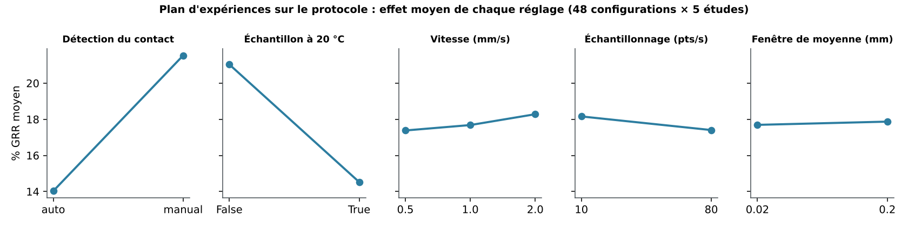
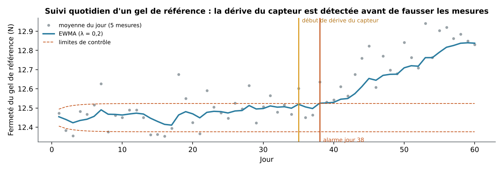
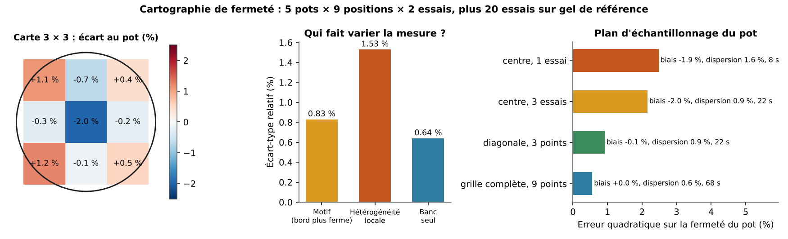
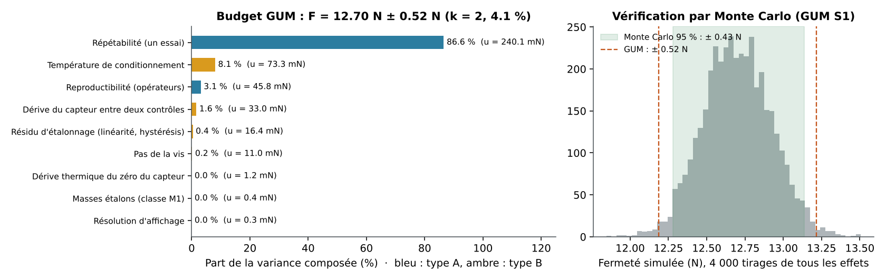
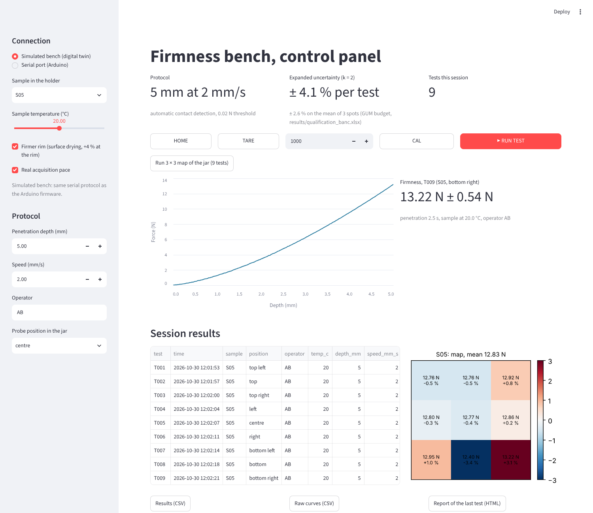

# force-bench-twin

**Digital twin and measurement-system qualification of a low-cost firmness bench for cosmetic creams.**

Before buying a single component, can we prove that a simple bench (load cell, stepper axis, Arduino) will measure
cream firmness *repeatably and reproducibly*, and which protocol makes it so? This project models every source of
variation of such a bench, then qualifies it the way a metrology lab would: dead-weight calibration, Gage R&R (ANOVA),
a design of experiments on the test protocol, a 3 × 3 firmness map of the jar, an uncertainty budget (GUM) checked by
Monte Carlo, and daily drift monitoring on a reference gel. A control application and the firmware for the real bench
share the same serial protocol, so the software is ready for the first hardware test.

> Everything here is **simulated**. Component behaviour uses explicit, order-of-magnitude assumptions (listed in
> `src/bench.py`) meant to be replaced by measured values once the bench exists. The value of the project is the
> method and the tooling, which apply unchanged to real data.

## The bench

```
   stepper + lead screw (Z axis) ──► spherical probe ──► cream sample
                │                           │
           STEP/DIR                   5 kg load cell ──► HX711 24-bit ADC
                └──────────── Arduino ──────┘  ──► serial CSV  t_ms, z_mm, force_n
```

Measurement: force at 5 mm of penetration (firmness, N). Modelled sources of variation:

| Block | What varies |
| --- | --- |
| Sample | true firmness, speed dependence, spot-to-spot heterogeneity, temperature (-2 %/°C) |
| Load cell | gain error, non-linearity, hysteresis, thermal zero drift |
| ADC | noise depending on sampling rate (10 or 80 samples/s) |
| Axis | step resolution, backlash, speed ripple |
| Operator | how the surface (zero) is found: by eye, or automatically on a 0.02 N threshold |

## Results

| Step | Result |
| --- | --- |
| Calibration with dead weights (0 to 3 kg, up and down) | linearity error 0.06 % FS, hysteresis 0.10 % FS |
| Gage R&R, initial protocol (zero set by eye, room temperature) | **%GRR 24 %** (30 repeated studies: 21.5 to 27.5 %), ndc 6, *marginal* |
| Gage R&R, optimised protocol | **%GRR 9 %** (7.8 to 10.0 %), ndc 13, reproducibility ≈ 0, *acceptable* |
| Design of experiments, 48 protocols × 5 studies | automatic contact: 21.6 → 14.0 %; sample at 20 °C: 21.0 → 14.5 %; speed, rate and window: < 1 point each |
| Throughput | optimised test takes 7.5 s instead of 15 s for the same %GRR |
| Drift monitoring (EWMA on a reference gel) | sensor gain drift starting on day 35 detected on day 38, at 0.45 % bias |
| 3 × 3 firmness map (5 jars × 9 positions × 2 tests) | bench alone 0.6 %, cream local heterogeneity 1.5 %, rim/centre pattern 0.8 % (p = 0.002) |
| Sampling plan | centre only misses the firmer rim (bias −1.9 %); 3 diagonal spots: bias −0.1 %, error 0.9 % |
| Uncertainty budget (GUM), one test | **12.70 N ± 0.52 N (k = 2, ± 4.1 %)**; ± 2.6 % on the mean of 3 spots |
| Monte Carlo check (GUM Supplement 1, 4,000 draws) | 95 % interval ± 0.43 N: the GUM budget is consistent, slightly conservative |








### What the analysis says

- **The operator, not the sensor, was the problem.** Finding the surface by eye adds a personal bias of a few tenths of a
  millimetre; at 5 mm depth that is up to 0.3 N. Detecting contact on a force threshold removes the operator effect
  entirely: reproducibility falls to about zero. This is the first argument for automating the test.
- **Temperature matters as much as the operator.** At -2 %/°C, ±1.5 °C of room temperature is ±3 % on the result.
  Conditioning samples at 20 °C is the second lever.
- **Speed is free, sampling is not.** Testing four times faster changes nothing *as long as* the probe moves less than
  ~0.025 mm between two samples; at 2 mm/s and 10 samples/s the contact detection degrades and %GRR rises to 12-14 %.
  Hence the choice of 2 mm/s at 80 samples/s: twice the throughput, same quality.
- **What is left is the product, not the bench.** The test is quasi-destructive (each test at a new spot of the jar), so
  spot-to-spot heterogeneity of the cream ends up in the repeatability. The 3 × 3 map separates the two: the bench
  alone scatters 0.6 %, the cream 1.5 %. That is why repeatability is 87 % of the uncertainty budget.
- **Where you measure matters.** If the rim is firmer (surface drying, assumed +4 % at the rim), a centre-only test
  is biased by about −2 % on the jar; repeating it three times does not remove a bias. Three diagonal spots cost the
  same three tests and remove it. On a real product, the map tells which plan to adopt.
- **Temperature is the largest systematic term** of the budget (8 %). Its sensitivity (−2 %/°C) is an assumption: it
  is the first thing to measure on the real bench (`docs/validation_protocol.md`, step 4).

## Uncertainty budget

`src/uncertainty.py` builds the budget of one firmness test following the GUM (JCGM 100): type A terms from the bench
studies (repeatability, reproducibility), type B terms for what a repeatability study cannot see because it shifts every
test the same way (reference masses, calibration residual, conditioning temperature, thermal zero, sensor drift between
two daily checks, lead-screw pitch, resolution). It is then checked by Monte Carlo (JCGM 101): every effect is drawn
at random and the full bench model is run 4,000 times. The sheet `Budget_incertitude` of the Excel workbook holds the
same budget in formulas: change a half-width (e.g. from a real calibration certificate) and U updates.

## Control application



```bash
streamlit run app/control_app.py
```

HOME, TARE, CAL and RUN buttons, live force/depth curve, firmness with its expanded uncertainty, 3 × 3 map of the
current jar, CSV export (results and raw curves) and a one-page HTML report per test. It talks to the bench through
`src/bench_link.py`: by default a simulated bench that answers the **same serial protocol as the Arduino firmware**;
choose "Serial port" and the same application drives the real bench (pyserial).

## From simulation to the real bench

`docs/validation_protocol.md` lists the tests to run once the bench exists (3 to 4 days), and
`results/comparaison_simulation_reel.xlsx` is the template to confront each prediction of the twin with the real
measurement, with an acceptance criterion per line. The "real" column is empty on purpose: it will be filled with
measured values, never estimated ones.

## Excel workbook with live formulas

`results/qualification_banc.xlsx` recomputes everything from the raw measurements with Excel formulas (no macros): the
uncertainty budget,
full two-way ANOVA Gage R&R (sums of squares by `SUMPRODUCT`, interaction pooled when p > 0.25, %GRR, ndc, verdict), the
calibration fit (`SLOPE`, `INTERCEPT`, max error in % FS) and the EWMA chart with its alarm. Paste real measurements in
the `Mesures_*` sheets and the qualification updates. Checked against the Python results (LibreOffice recalculation):
same %GRR to 0.1 point, same alarm day.

## Power BI

`powerbi/` holds the tables for a star schema: `fact_mesures` (Gage R&R runs), `fact_plan_experiences`,
`fact_suivi_reference` (daily drift check), `fact_cartographie` (3 × 3 map), `dim_protocoles`, `dim_echantillons`,
`dim_budget_incertitude`.

## Run it

```bash
pip install -r requirements.txt
python src/run_all.py           # calibration, Gage R&R, DOE, drift, map, uncertainty, figures, Excel, Power BI (~10 s)
streamlit run app/control_app.py
pytest tests                    # 11 tests: Gage R&R, calibration, drift, map, GUM vs Monte Carlo, serial protocol
```

Firmware: `firmware/firmness_bench/firmness_bench.ino` (HX711 + AccelStepper; commands `HOME`, `TARE`, `CAL <g>`,
`RUN <depth> <speed>` with automatic contact detection and CSV streaming). Not yet run on hardware.

## Bill of materials for the real bench

5 kg straight-bar load cell, HX711 board (RATE pin high for 80 samples/s), NEMA 17 stepper with TMC/A4988 driver,
2 mm-lead screw and guide rail, limit switch, 10 mm spherical probe, Arduino board, 3D-printed sample holder, a set of
calibration masses, a reference gel for the daily check.

## Method references

AIAG, *Measurement Systems Analysis (MSA)*, 4th edition (Gage R&R ANOVA method, ndc). ISO 5725 (accuracy, repeatability
and reproducibility of measurement methods). JCGM 100:2008, *Guide to the expression of uncertainty in measurement*
(GUM), and JCGM 101:2008 (Monte Carlo propagation). OIML R111 (mass standards). Montgomery, *Introduction to
Statistical Quality Control* (EWMA charts).

## Licence

MIT
